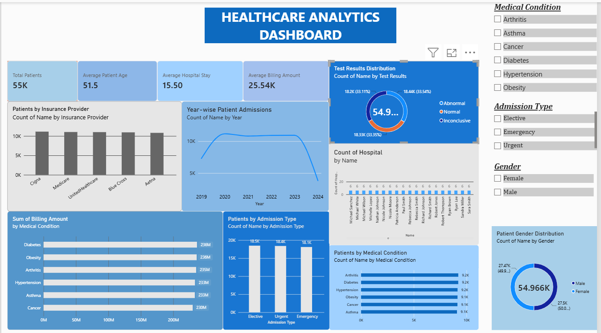

# Healthcare Analytics Dashboard

An interactive Healthcare Analytics Dashboard developed using **Microsoft Power BI** to analyse hospital admission records, patient demographics, medical conditions, billing information, and healthcare trends.

## Project Overview

The Healthcare Analytics Dashboard helps explore healthcare data through interactive visualisations and key performance indicators (KPIs).

It provides an overview of patient admissions, medical conditions, gender distribution, insurance providers, hospital stays, billing amounts, and test results.

## Dashboard Preview

## Dataset

- **Dataset:** Healthcare Dataset
- **Source:** [Kaggle – Healthcare Dataset](https://www.kaggle.com/datasets/prasad22/healthcare-dataset)
- **Records:** Approximately 55,500
- **Columns:** 15

The dataset includes information such as:
- Patient Name, Age and Gender
- Blood Type and Medical Condition
- Date of Admission and Discharge
- Hospital and Doctor
- Insurance Provider
- Billing Amount
- Admission Type
- Medication and Test Results

**Note:** This is a synthetic/demo dataset. It does not represent actual patient records or real hospital outcomes.

## Tools & Technologies

- Microsoft Power BI
- Power Query – Data Cleaning and Transformation
- DAX – Calculated Measures and KPIs
- Kaggle – Dataset Source

## Data Preparation

The following data preparation steps were performed:

1. Removed duplicate records.
2. Standardised patient name formatting.
3. Checked column data types.
4. Reviewed data quality and missing values.
5. Loaded the prepared data into Power BI.

## Key Performance Indicators (KPIs)

The dashboard includes the following KPIs:

- Total Patients
- Average Patient Age
- Average Hospital Stay
- Average Billing Amount

## Dashboard Visualisations

The dashboard contains visualisations for:

1. Medical Condition Analysis
2. Gender Distribution
3. Admission Type Analysis
4. Insurance Provider Analysis
5. Test Results Distribution
6. Billing Analysis by Medical Condition
7. Monthly Admission Trends
8. Hospital-wise Patient Analysis

## Interactive Features

The dashboard includes slicers for:

- Gender
- Medical Condition
- Admission Type

These filters allow users to explore different segments of the healthcare dataset.

## Key Learning Outcomes

Through this project, I gained practical experience in:

- Data cleaning and transformation using Power Query.
- Creating calculated measures using DAX.
- Designing interactive dashboards.
- Selecting appropriate charts for data visualisation.
- Analysing healthcare-related datasets.
- Presenting data insights in a structured and visual format.

## Project Files

- `.pbix` – Power BI dashboard project file.
- `dashboard-preview.png` – Dashboard screenshot.

## Future Improvements

- Add more detailed healthcare analysis.
- Improve interactive filtering.
- Include additional KPIs and visual insights.
- Explore more advanced Power BI features.

---

**Project:** Healthcare Analytics Dashboard  
**Tool:** Microsoft Power BI  
**Category:** Data Analytics & Visualisation
